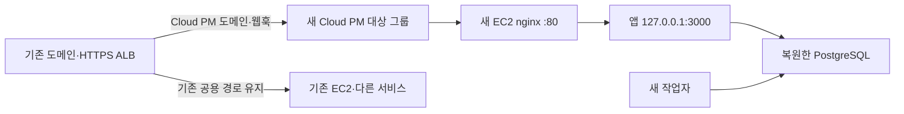

# 기존 도메인을 유지하고 새 EC2로 이전하기

대상은 `cloud-pm.soldoc.co.kr`의 기존 서비스다. 새 EC2에 앱·작업자·PostgreSQL을 옮기며 기존 계정·소유자·데이터·GitHub App을 유지한다. 새 조직의 첫 설정은 [운영 튜토리얼](operations-tutorial.md)을 참고한다. **실제 전환은 새 인스턴스 ID와 점검 시간이 정해진 뒤 수행한다.**

## 현재 구성과 유지할 항목

2026-11-05 AWS 조회 기준이다.

| 항목                 | 기존 값                                                  |
| -------------------- | -------------------------------------------------------- |
| 리전                 | `ap-northeast-2`                                         |
| 기존 EC2             | `i-0ea0fe35a37c9d3cd`, `t3.micro`, `x86_64`              |
| 새 EC2               | `i-0d478cc462d8b6f4e`, `t4g.small`, `arm64`              |
| 새 EC2 보안 그룹     | `sg-087d85224c7996305`, ALB 보안 그룹에서 HTTP 80만 허용 |
| 새 EC2 루트 디스크   | 암호화 `gp3` 32GiB                                       |
| VPC                  | `vpc-032c508fba5c47150`                                  |
| 기존 서브넷          | `subnet-0ae1f974e15ae353e`                               |
| 기존 ALB             | `alb-internal-bastion-host`                              |
| 기존 공용 대상 그룹  | `internal-bastion-host`, HTTP 80, `/health`              |
| 앱·작업자 릴리스     | `team-planning-20261105`                                 |
| GitHub 조직·App·설치 | `soldoc-kr` · `5589960` · `178059528`                    |
| 기본 공간 소유자     | 서비스 아이디 `hyeokju98`                                |

기존 DNS·ALB·HTTPS 인증서·GitHub App 등록과 설치를 유지한다. `DOMAIN`, `TOKEN_ENCRYPTION_KEY`, App 개인 키·OAuth Secret·웹훅 secret도 그대로 가져온다. 동일 도메인이므로 Callback·Webhook·Claude MCP 주소는 변경하지 않는다. 최초 소유자 가입도 다시 하지 않는다.

**공용 대상 그룹의 기존 EC2를 새 EC2로 교체하지 않는다.** HTTPS 리스너의 기본 동작과 GitHub 웹훅 규칙 100~103이 이 그룹을 사용한다. 새 EC2는 Cloud PM만 실행하므로, Cloud PM 전용 대상 그룹과 도메인 규칙으로 분리하고 기존 기본 동작·다른 서비스는 유지한다.



## 1. 새 EC2 준비

1. 기존 ALB와 연결 가능한 같은 VPC에서 생성한다. ALB가 활성화한 가용 영역과 서브넷·라우팅을 확인한다. 이번 목적지는 **t4g.small / ARM64**이며 기존 x86_64 이미지는 사용할 수 없으므로 ARM64로 다시 빌드한다.
2. Docker Engine·Compose v2 이상·nginx와 SSM 접속을 준비한다. 앱 빌드는 기존처럼 개발·CI에서 수행해 전달할 수 있다. 현재 메모리가 약 1GiB이므로 새 용량은 앱·작업자·DB의 실제 사용량과 증가 여유를 고려한다.
3. 새 보안 그룹은 **ALB 보안 그룹에서 오는 80번**과 필요한 관리 경로만 허용한다. 앱의 3000번·DB의 5432번은 인터넷에 공개하지 않는다. 외부 DB를 쓴다면 새 EC2에서 DB로의 접근과 TLS를 별도로 허용한다.
4. `/opt/cloud-pm-agent`를 만들고 Compose·nginx 설정·검증한 웹/작업자 이미지를 준비한다. nginx의 OS별 기본 서버 설정과 `default_server`가 중복되지 않게 구성하고 `nginx -t`로 확인한다.

현재 운영과 같은 `compose.ec2.yaml`은 로컬 PostgreSQL을 포함한다. ALB가 TLS를 종료하고 호스트 nginx가 앱으로 전달하므로 Caddy를 함께 실행하지 않는다. nginx 설정은 [deploy/nginx.ec2.conf](../deploy/nginx.ec2.conf)를 사용한다.

## 2. 이미지·설정을 안전하게 전달

개발·CI 환경에서 운영과 같은 소스 버전으로 ARM64 이미지를 빌드한다. 이후 앱 코드가 업데이트됐다면 실제 운영 릴리스에 맞춘다. 빌드를 새 EC2에서 수행할 필요는 없다.

```sh
docker build --platform linux/arm64 --target web -t cloud-pm-agent:web-team-planning-20261105-arm64 .
docker build --platform linux/arm64 --target worker -t cloud-pm-agent:worker-team-planning-20261105-arm64 .
docker save -o cloud-pm-images.tar cloud-pm-agent:web-team-planning-20261105-arm64 cloud-pm-agent:worker-team-planning-20261105-arm64
sha256sum cloud-pm-images.tar > cloud-pm-images.tar.sha256
```

macOS에서 해시를 만들 때는 `shasum -a 256`을 사용한다. 이미지·해시·기존 `.env.production`·`compose.ec2.yaml`을 보호된 전송 경로로 새 서버에 가져온다. 비밀 설정을 SSM 명령 본문이나 채팅에 붙이지 않는다.

**새 서버의 환경 파일만** `RELEASE=team-planning-20261105-arm64`로 맞춘다. 기존 서버의 릴리스와 다른 비밀값은 유지한다. PostgreSQL의 논리 백업(`pg_dump`/`pg_restore`)으로 기존 x86_64 DB를 ARM64에 복원하며 데이터 디렉터리를 직접 복사하지 않는다.

새 EC2에서 실행한다.

```sh
cd /opt/cloud-pm-agent
umask 077
sha256sum --check cloud-pm-images.tar.sha256
docker load -i cloud-pm-images.tar
chmod 600 .env.production
docker compose --env-file .env.production -f compose.ec2.yaml config --quiet
docker compose --env-file .env.production -f compose.ec2.yaml up -d db
```

이 시점에는 새 앱·작업자를 시작하지 않는다. 기존 환경은 그대로 서비스한다. 새 DB가 비어 있는지 확인하고, 사전 복원 연습은 최종 목적지와 다른 임시 DB에서 한다. 운영 토큰이 들어 있는 복제본을 연습한다면 새 작업자·자동 동기화·외부 이슈 발행을 실행하지 않는다.

DB를 새 EC2의 컨테이너 대신 RDS 등에 둔다면 [외부 DB 구성](operations-tutorial.md#3-새-환경-db와-실행-구성을-준비한다)을 사용한다. 기존 ALB를 쓸 때 외부 DB Compose의 Caddy 대신 호스트 nginx와 앱의 loopback 포트를 구성해야 한다.

## 3. Cloud PM 전용 대상 그룹 준비

AWS 콘솔에서 아래와 같이 새 대상 그룹을 만든다. 이 작업과 이후 규칙 수정은 전환 계획을 검토한 뒤 실행한다.

| 설정           | 값                  |
| -------------- | ------------------- |
| 대상 유형      | Instances           |
| VPC            | 기존 ALB와 같은 VPC |
| 프로토콜·포트  | HTTP · 80           |
| 상태 검사 경로 | `/health`           |
| 대상           | 새 EC2 · 80         |

nginx의 `/health`가 앱의 `/api/health`를 검사한다. 새 대상 그룹이 리스너에 연결되지 않으면 `unused`일 수 있으므로, 등록만 하고 즉시 `healthy`가 될 것으로 판단하지 않는다. 전환 시 운영자 IP에 한정한 임시 테스트 규칙으로 연결해 검증한다.

기존 리스너 규칙·기본 동작·대상 그룹·보안 그룹과 앱/DB 버전을 파일로 보관한다. 운영 규칙의 source-IP·메서드·경로 조건도 보존한다. GitHub 웹훅 전용 규칙은 같은 도메인이더라도 별도로 대상 그룹을 변경해야 한다.

## 4. 점검 시작: 최종 백업

1. 팀에 점검 시간을 알린다. Cloud PM 도메인에 한정한 임시 **503 고정 응답 규칙**을 기존 웹훅 규칙보다 높은 우선순위로 적용한다. 다른 도메인의 기본 경로는 유지한다.
2. 처리 중인 HTTP·MCP 요청이 끝나고 새 요청이 기존 앱에 기록되지 않는 것을 확인한다. 긴 요청이 남았다면 종료 결과를 확인한다. 상태 검사를 실패시키는 것만으로 쓰기 차단을 대신하지 않는다.
3. 기존 worker를 정상 종료하고 기존 app을 중지한다. 이 앱을 쓰는 별도 CLI·stdio MCP·스케줄러도 확인한다.
4. 활성 동기화 임대가 0인지 확인하고 최종 백업을 만든다. 명령은 [최종 백업 절차](operations-tutorial.md#6-2-기존-환경의-쓰기를-멈추고-최종-백업한다)를 따른다.
5. 백업 파일과 SHA-256을 새 EC2에 전달해 검증한다. 기존 DB와 볼륨은 유지한다.

기존 EC2 전체를 중지하거나 nginx를 중지하지 않는다. Cloud PM의 app·worker만 중지하며 다른 프로세스는 유지한다. 점검 중 GitHub delivery가 실패하면 전환 후 확인·재전송한다.

## 5. 새 EC2에 DB 복원

새 EC2의 `/opt/cloud-pm-agent`에서 실행한다. 빈 DB에 복원하며, 기존 데이터를 덮어쓰는 명령은 포함하지 않는다.

```sh
set -eu
docker compose --env-file .env.production -f compose.ec2.yaml exec -T db pg_restore -U cloudpm -d cloud_pm --exit-on-error --single-transaction --no-owner --no-privileges < migration-backup/cloud-pm.dump
docker compose --env-file .env.production -f compose.ec2.yaml exec -T db psql -U cloudpm -d cloud_pm -Atc "SELECT w.id,u.login,m.role FROM workspace_settings w JOIN app_users u ON u.id=w.owner_id JOIN workspace_members m ON m.workspace_id=w.id AND m.user_id=u.id;"
docker compose --env-file .env.production -f compose.ec2.yaml up -d --no-deps --wait --wait-timeout 120 app
curl --fail --silent --show-error http://127.0.0.1:3000/api/health
curl --fail --silent --show-error -H 'Host: cloud-pm.soldoc.co.kr' http://127.0.0.1/health
```

소유자 조회에 `main|hyeokju98|owner`가 보여야 한다. 작업자는 아직 실행하지 않는다. 앱 자체와 nginx를 통한 헬스가 모두 정상이어야 한다.

## 6. 운영자만 먼저 확인

임시 점검 규칙보다 높은 우선순위에 **Host = cloud-pm.soldoc.co.kr + Source IP = 운영자 IP/32 → 새 대상 그룹**인 테스트 규칙을 둔다. 기존 접근 제한은 유지하며 새로운 공개 허용 규칙을 만들지 않는다.

새 대상이 `healthy`가 된 뒤 동일한 운영 도메인으로 확인한다.

- 기존 소유자 계정 로그인·역할, 프로젝트·PRD·태스크·정책·용어·스프린트 수
- GitHub OAuth 시작·계정 연결, 담당자 매칭·리소스 계획
- 테스트용 항목의 저장·수정·파일 미리보기와 조회 전용 권한
- MCP 초기화·도구 조회·개인 토큰 권한

두 서버가 서로 다른 DB에 동시에 수정 내용을 받게 하지 않는다. 이 단계에서 새 DB에 수정한 데이터도 전환 결과의 일부이므로, 복구할 때 보존해야 한다.

## 7. Cloud PM 경로만 전환

1. 기존 GitHub 웹훅 규칙 **100~103의 조건은 유지하고 forward 대상만 새 그룹으로 변경**한다.
2. Cloud PM 호스트에만 적용하는 새 운영 규칙을 만들어 새 그룹으로 연결한다. 기존 웹훅 규칙보다 낮은 우선순위를 사용하고, 리스너 기본 동작은 그대로 둔다. 실제 빈 우선순위를 확인하고 작업한다.
3. 새 worker를 시작하고 DB·앱·작업자의 상태를 확인한다.

   ```sh
   docker compose --env-file .env.production -f compose.ec2.yaml up -d --no-deps worker
   docker compose --env-file .env.production -f compose.ec2.yaml ps
   ```

4. 임시 503 점검 규칙을 제거해 사용을 재개한다. 운영자 테스트 규칙도 정리하고 일반 접속·GitHub 웹훅·Claude 요청이 의도한 경로로 연결되는지 확인한다.
5. 점검 중 실패한 GitHub delivery와 작업 큐를 확인한다. 새 서버에서 처리되는 것을 확인하고 필요한 경우에만 재전송·누락 동기화를 한다.
6. 기존 Cloud PM app·worker는 중지한 상태로 두고, 자동 재기동·배포 작업이 이를 다시 올리지 않도록 한다. 기존 EC2의 다른 서비스와 공용 대상 그룹은 유지한다.

대상 등록 해제 시에는 처리 중 요청의 drain을 고려한다. 이번 이전은 공용 대상 전체를 등록 해제하는 방식이 아니며, 기존 연결이 남았는지도 별도로 확인한다. [AWS 대상 전환·연결 종료](https://docs.aws.amazon.com/elasticloadbalancing/latest/application/target-group-register-targets.html)

## 8. 복구 기준

새 DB에 새 쓰기가 없다면 점검 응답을 복구하고 새 app·worker를 멈춘 뒤, Cloud PM 호스트·웹훅 동작을 이전 그룹으로 되돌리고 기존 app·worker를 재개할 수 있다.

새 DB에서 가입·편집·이슈 발행 등을 받았다면 점검 상태에서 최종 데이터를 보존해 역이관하거나 새 환경에서 수정한다. 기존 DB로 경로만 돌리면 새 작업이 사라진 것처럼 보일 수 있다. 외부 GitHub 발행도 함께 확인한다.

기존 EC2 전체 종료·EBS 삭제·기존 DB 제거는 이 절차에 포함하지 않는다. 다른 서비스와 데이터 보존 확인 후 별도 정리한다.
