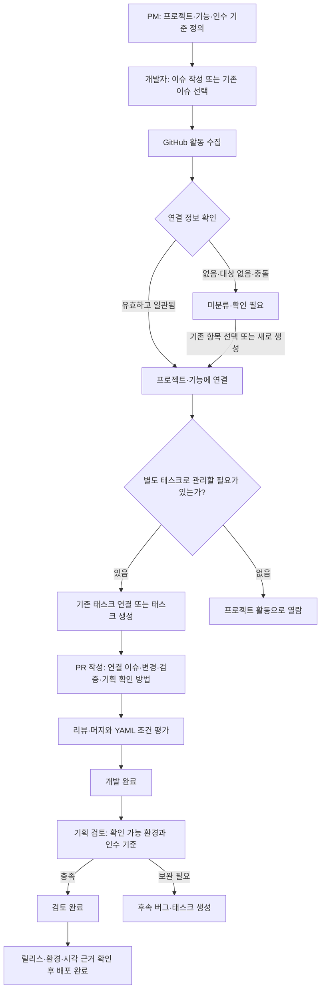

# GitHub 활동 분류와 개발·기획 협업 워크플로우 초안

상태: **제품·연결 규칙 제안**. 아래 템플릿은 배포용 예시이며, 자동 연결·미분류함·별도 기획 검토 상태는 아직 구현되지 않았다. 서비스 계정 가입, 관리자 공용 GitHub 연결, PRD·정책·용어집, PRD에서 태스크·GitHub 이슈 생성은 구현되어 있다. 현재 시스템은 프로젝트·기능·태스크 관리, 수동/후보 연결, YAML 완료 판정을 제공한다. 이 문서는 해당 기능을 다음 흐름으로 확장하기 위한 기준이다.

완료 조건 파일과 Actions 워크플로·PRD 본문 연결 YAML의 차이는 [태스크 완료 조건 설정](task-completion-setup.md)을 참고한다.

## 1. 기본 원칙

- 기획자는 이 페이지에서 목표·인수 기준·우선순위를 관리한다. 개발자는 GitHub에서 구현 범위·PR·검증 결과를 작성한다.
- GitHub는 이슈·PR·코드·리뷰의 원본이다. cloud-pm-agent는 업무 구성·분류·검토의 원본이다. 페이지에서 분류한 내용이 GitHub 본문을 자동 수정하지 않는다.
- 모든 활동에 태스크를 강제로 만들지 않는다. 프로젝트만 연결한 이슈·PR도 수집·열람할 수 있어야 한다.
- 명시적 연결은 규칙으로 처리하고, 추측은 후보로 제안한다. 미분류·충돌을 정상적인 처리 대상으로 둔다.
- 태스크는 직접 완료하거나 YAML의 PR 머지 조건으로 자동 완료한다. 기획 검토와 배포 완료는 별도 근거를 요구한다.

## 2. 역할과 데이터 접근

| 역할             | 주요 책임                                                             |
| ---------------- | --------------------------------------------------------------------- |
| 조직 연동 관리자 | GitHub App 설치, 허용 저장소 선택, 워크스페이스별 공유 범위 설정      |
| PM·기획자        | 프로젝트·기능 정의, 미분류 활동 배정, 우선순위·담당자 정리, 인수 검토 |
| 개발자           | 작업 범위·연결 이슈 작성, PR 검증 결과, YAML 완료 조건 등록           |
| 리뷰어           | 코드·테스트 검토와 머지 승인                                          |

목표 구조는 **조직의 GitHub App으로 수집하고 서비스 계정으로 열람하는 방식**이다. 비개발자는 이메일 초대/회사 SSO로 참여하며 GitHub 계정이 필요 없다. 역할은 업무상 책임이며 계정의 워크스페이스 권한과 별개다. PM도 조회 전용 역할이면 수정할 수 없다.

관리자가 허용한 저장소를 워크스페이스에 공유하고, 사용자의 프로젝트 접근 권한을 검사한다. 본문의 workspace/project 값은 권한을 부여하지 않는다. 현재 서비스 아이디·비밀번호 가입, 지정 워크스페이스의 GitHub App 연동과 공용 PAT 연결을 제공한다. 이메일 초대 전송·회사 SSO는 후속 범위다.

## 3. 권장 흐름



### 프로젝트와 기능 준비

PM이 목표·저장소·일정을 가진 프로젝트와 사용자 결과 중심의 기능을 등록한다. 기능은 브랜치 이름과 독립적이며 기술 개선·운영 작업도 포함할 수 있다. 목표와 인수 기준은 PM이 관리하고, 개발자는 구현 태스크와 필요한 하위 작업·의존성을 정리한다.

페이지는 선택한 프로젝트·기능의 **연결 정보 복사**와 **이슈 템플릿 다운로드**를 제공하는 방향으로 구현한다. GitHub 계정이 없는 기획자는 페이지에 업무를 등록하고 개발자가 GitHub 이슈에 연결한다. 현재 PRD를 태스크로 전환한 뒤 대상 저장소와 본문을 확인하여 GitHub 이슈를 생성할 수 있다. 기존 이슈 본문 자동 갱신은 제공하지 않는다.

### 이슈 작성

이슈는 독립적으로 설명·검증할 수 있는 작업 단위로 작성한다. 제목은 `[기능] 로그인 실패 안내`, `[버그] 초대 링크 만료 오류`처럼 결과나 현상을 표현한다. 기존 저장소의 제목 규칙이 있으면 그 규칙을 유지한다.

필수 정보는 목적/현상, 작업 범위/재현 방법, 기대 결과/인수 기준이다. 연결 정보는 모르면 비워 둔다. 프로젝트·기능·태스크를 모두 미리 만들어야 이슈를 등록할 수 있는 흐름은 피한다.

### 분류와 태스크 전환

미분류함에서 원문·작성자·담당자·저장소·최근 변경과 연결 후보를 함께 보여 준다. PM은 개별/선택/일괄 배정, 새 프로젝트·기능 생성 후 연결, 태스크 전환, 연결 해제, 관리 대상 제외를 수행한다.

프로젝트만 아는 경우 프로젝트에 먼저 배정한다. 기능은 추후 지정할 수 있고, 태스크를 만들 때는 현재 모델에 맞게 기능을 선택한다. 대상 ID가 없으면 임의로 새 항목을 생성하지 않고 기존 항목 선택/명시적 생성으로 해결한다. 관리 대상 제외는 삭제와 구분하고 사유·복원 기능을 둔다.

### PR 작성과 개발 완료

PR에는 연결 이슈, 사용자에게 달라지는 점, 검증 결과, 기획 확인 방법을 작성한다. 이슈에 분류·인수 기준이 있으면 PR에 반복 입력하지 않고 링크로 이어받는다. 이슈 없는 긴급 수정도 PR을 만들 수 있고 연결 정보를 직접 지정하거나 미분류함에서 배정한다.

부분 구현 PR은 `Refs owner/repo#42`처럼 참조한다. 이슈 전체를 해결하는 마지막 PR에만 `Closes owner/repo#42`를 사용한다. `Refs`는 이 시스템에서 참조를 수집할 문자열 규칙이며 GitHub 자동 종료 키워드가 아니다. 여러 저장소의 PR이 필요하면 태스크 YAML의 `all` 조건으로 완료를 판단한다.

GitHub의 종료 키워드는 기본 브랜치를 대상으로 하는 PR에서 해석된다. 이슈가 닫혔다는 사실과 내부 태스크의 완료는 분리한다. YAML은 기존 명세대로 저장소 기본 브랜치에서 활성화하며 PR 번호·대상 브랜치를 명시한다. 브랜치 이름, PR 승인, 이슈 종료만으로 태스크를 완료하지 않는다.

### 기획 검토와 배포

개발 완료 후 확인 환경·URL·테스트 계정 제공 여부를 표시한다. 기획자는 인수 기준별 확인 결과·근거·보완 내용을 기록한다. 확인 환경이 없으면 검토 대기로 둔다. 보완이 필요하면 완료된 태스크의 이력을 유지하고 후속 작업을 연결한다.

배포는 실제 릴리스/배포 기록·환경·시각을 확인한 뒤 표시한다. 머지 시점에 출시를 단정하지 않는다. 검토·배포 순서는 팀의 릴리스 절차에 따라 달라질 수 있으며 세 상태는 독립적으로 기록한다.

## 4. 자동 연결 판정 규칙

워크스페이스별 등록 저장소·공유 범위 안에서만 판정한다. 같은 저장소를 여러 공간에서 사용해도 모든 공간에 자동 배포하지 않는다.

| 근거                          | 기본 처리                                                  |
| ----------------------------- | ---------------------------------------------------------- |
| 사람이 확정·고정한 연결       | 우선 보존. 원본 변경과 차이가 생기면 재검토 표시           |
| 본문의 유효한 연결 정보       | 존재·소속·권한과 연결 이슈의 정보를 확인한 뒤 자동 연결    |
| PR이 명시적으로 참조한 이슈   | 수집·접근 가능한 이슈들의 분류가 일치하면 이어받기         |
| 저장소별 기본 프로젝트        | 관리자가 자동 적용을 켰고 대상이 하나일 때 프로젝트만 연결 |
| 제목·파일 경로·라벨·AI 유사도 | 근거가 있는 후보 제안. 자동 확정하지 않음                  |

PR의 직접 지정과 이슈 분류가 충돌하거나 참조 이슈들이 서로 다른 기능에 속하면 **확인 필요**로 둔다. 여러 기능에 걸친 변경은 PM이 복수 연결을 확정할 수 있다. 단순한 본문 속 `#숫자`는 PR/이슈 구분이 불명확하므로 존재와 종류를 확인한다. 이슈 링크가 아직 수집되지 않았으면 연결 정보 없음이 아니라 **원본 확인 대기**로 둔다.

PR의 참조는 GitHub가 제공하는 연결 관계와 본문에 명시된 이슈 URL·`Refs`·종료 키워드에서 추출한다. HTML 주석, 일반 코드 블록, 인용문에 들어 있는 예시 참조는 제외한다. `Cloud PM 연결` 블록은 별도로 파싱하되 주석·인용 속 예시를 실제 연결 정보로 취급하지 않는다.

직접 지정한 ID의 소속이 맞지 않으면 부분적으로 추측해 연결하지 않는다. task만 유효하면 해당 태스크의 프로젝트·기능을 확인하여 보완할 수 있고, 함께 적힌 project/feature가 다르면 충돌로 처리한다. 프로젝트만 유효하고 다른 필드를 작성하지 않았으면 프로젝트 연결을 허용한다.

재동기화는 수동 연결을 덮어쓰거나 해제한 관계를 다시 자동 생성하지 않는다. 판단 근거·방식·원본 버전·결정자·시간을 기록한다. 중복 수집과 재시도에는 같은 연결을 재사용하고, 동시 수정에는 revision 충돌을 반환한다. 일괄 처리의 부분 실패는 항목별로 표시하여 성공한 작업을 중복 생성하지 않고 재시도한다.

## 5. 템플릿과 연결 정보 계약

복사할 파일은 [템플릿 배포 안내](../examples/github-templates/README.md)에 있다. GitHub Issue Forms의 입력은 제출 후 Markdown으로 변환된다. 폼의 내부 `id`는 본문에 나타나지 않으므로 연결 파서는 **`Cloud PM 연결` 제목 바로 아래의 YAML 코드 블록**을 읽는 방식으로 구현한다. 이 계약은 아직 파서 구현이 없는 제안이다.

```yaml
version: 1
workspace: product-team
project: customer-platform
feature: social-login
task: TASK-123
```

`version`은 필수이며 1을 사용한다. 나머지는 선택적 식별자로서 빈 값/null은 미지정이다. 이름이나 GitHub URL을 ID 대신 넣지 않는다. 식별자는 현재 서비스와 동일하게 영문·숫자·`_`·`-`, 최대 100자이다. workspace를 생략하면 관리자가 정한 저장소→워크스페이스 범위 안에서 판정한다. project를 생략하고 feature/task를 지정하면 존재하는 항목의 소속으로 보완한다. 여러 블록, 잘못된 스키마/중복 키, 서로 다른 버전은 확인 필요로 처리한다.

기존 완료 조건 YAML(`.cloud-pm/tasks/*.yaml`)과 본문의 연결 블록은 목적이 다르다. 본문 블록은 분류 정보만 제공하고 완료 조건을 활성화하지 않는다. 현재 제공 예제는 공용 템플릿이며, 프로젝트별 내보내기에서 ID를 미리 채우는 기능은 추후 구현한다.

| 템플릿         | 사용 시점               | 필수 작성                                                        | 선택 작성                             |
| -------------- | ----------------------- | ---------------------------------------------------------------- | ------------------------------------- |
| 기능·개선 이슈 | 사용자 기능 추가·개선   | 목적, 범위, 인수 기준                                            | 연결 정보, 제외 범위·의존성           |
| 버그 이슈      | 오류·회귀               | 현상, 재현, 기대 동작, 영향                                      | 연결 정보, 환경·증거                  |
| 기술·운영 이슈 | 리팩터링·운영·기술 부채 | 필요성, 범위, 검증 방법                                          | 연결 정보, 위험·복구                  |
| PR             | 구현 변경 제출          | 연결 근거 또는 미분류 사유, 변경 요약, 검증 결과, 기획 확인 방법 | 사용자 영향, 환경 URL, 위험·후속 작업 |

GitHub 폼의 필수 입력만으로 정보 품질이나 PR 규칙이 보장되지는 않는다. 첫 단계에는 누락 안내·미분류함을 제공하고, 팀이 합의한 뒤 선택적으로 PR 검사를 켠다. 라벨은 보조 표식이며 임의 라벨이나 브랜치 접두사로 접근 권한·완료 상태를 정하지 않는다.

## 6. PM 화면과 집계

PM은 **미분류·연결 충돌 → 담당자/선행 대기 → 개발 완료·검토 대기 → 배포 확인** 순서로 확인한다. 각 항목은 원본 링크와 마지막 수집 시각을 함께 보여 준다. 작성자·담당자·리뷰어는 역할을 구분하고, 작성자를 실제 작업 담당자로 단정하지 않는다.

프로젝트에 연결된 활동 수와 태스크 진행률은 구분한다. 이슈와 PR이 같은 태스크에 연결되어도 완료 집계는 태스크 한 건이다. 태스크가 없는 프로젝트는 “집계 대상 태스크 없음”으로 표시한다. 미분류·검토·배포 상태를 개발 완료율의 분모에 섞지 않는다.

## 7. 구현 순서와 수용 기준

1. **조직 연동·비개발자 계정**: GitHub 없는 사용자도 초대·권한에 따라 허용 프로젝트를 조회한다.
2. **활동 분류 모델·미분류함**: 태스크 없이 프로젝트만 연결하고 일괄 배정·해제·제외·복원한다.
3. **연결 블록 파서·규칙 연결**: 정상 ID, 누락, 잘못된 소속, 충돌, 수집 대기, 권한 밖 참조를 구분한다.
4. **템플릿 내보내기**: 프로젝트·기능 선택으로 ID가 채워진 파일을 만들고 기존 저장소 파일은 덮어쓰지 않는다.
5. **PR 이슈 상속**: 단일/복수·저장소 간 이슈·부분 구현·누락 원본을 검증한다. 수동 확정은 재동기화 후에도 유지한다.
6. **기획 검토·배포 근거**: 개발 완료와 독립된 상태·근거·후속 작업을 기록한다.

예시: PM이 로그인 기능과 인수 기준을 만들고 개발자가 이슈 #42를 연결한다. 백엔드 PR #142와 프론트엔드 PR #87이 같은 이슈를 참조하면 같은 기능/태스크로 모인다. YAML의 두 PR 머지 조건이 충족되면 개발 완료이고, PM의 스테이징 검토와 실제 배포 근거는 별도로 기록한다. ID 없는 기존 이슈 #9는 미분류함에서 프로젝트에만 배정할 수 있다.

참고: [Issue Forms 문법](https://docs.github.com/en/communities/using-templates-to-encourage-useful-issues-and-pull-requests/syntax-for-issue-forms) · [폼 스키마](https://docs.github.com/en/communities/using-templates-to-encourage-useful-issues-and-pull-requests/syntax-for-githubs-form-schema) · [이슈·PR 연결 규칙](https://docs.github.com/en/issues/tracking-your-work-with-issues/using-issues/linking-a-pull-request-to-an-issue) · [기존 완료 조건](task-completion.md)
